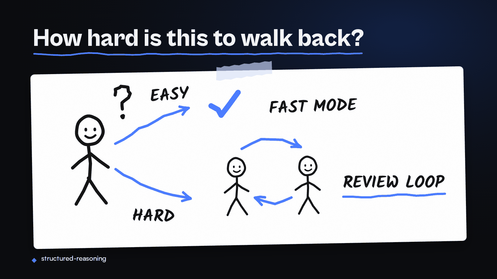
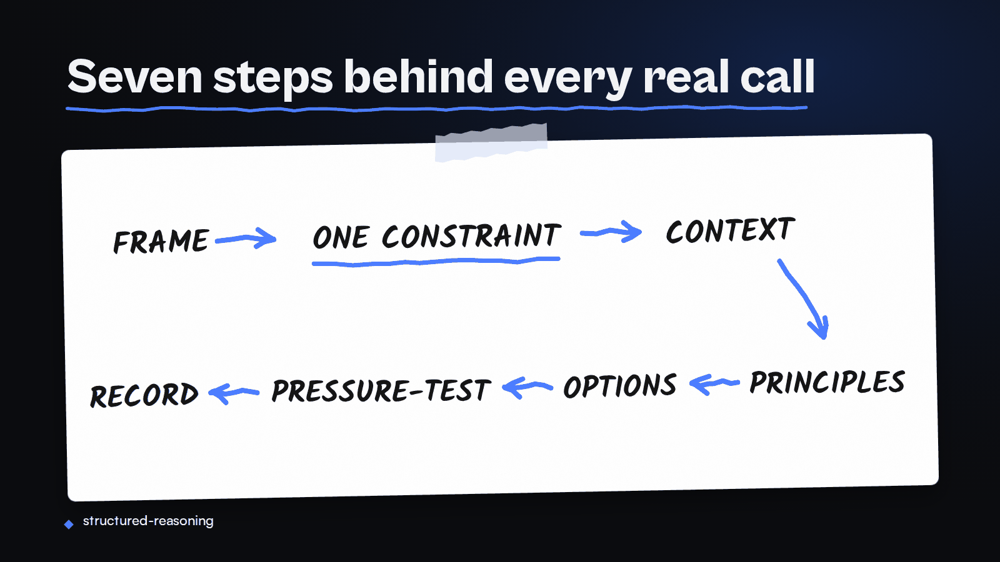
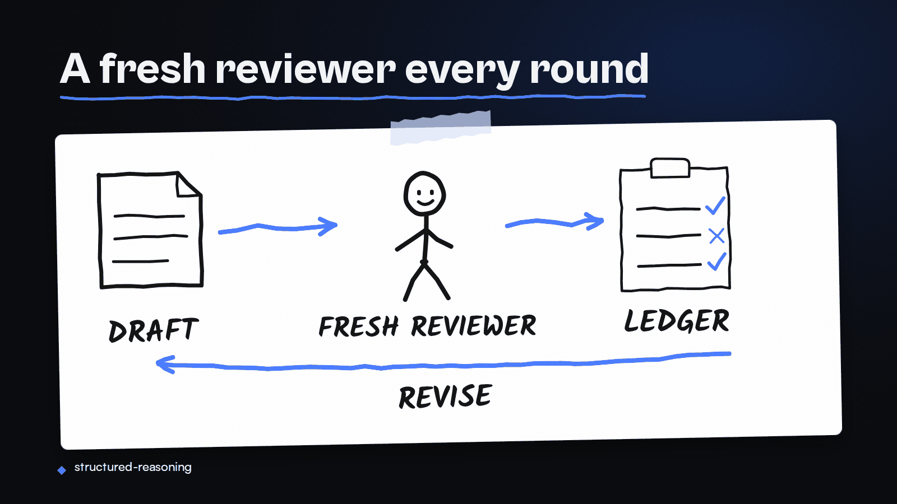

# Structured Reasoning

**A decision skill for coding agents.** Your agent reasons through consequential calls the same way every time, and sends the hard-to-undo ones to an independent reviewer before it commits.

Works with Claude Code, Codex, OpenCode and any agent that loads `SKILL.md` skills. Works with one model provider or several. MIT licensed.



```bash
# Claude Code, personal install
git clone https://github.com/JJValentin/structured-reasoning ~/.claude/skills/structured-reasoning
```

Other agents and project installs: see [Install](#install). Setting it up through your agent: see [For AI agents](#for-ai-agents).

## Contents

- [Why not just ask the model?](#why-not-just-ask-the-model)
- [Install](#install)
- [Use it](#use-it)
- [How it works](#how-it-works)
- [Worked example](#worked-example)
- [One provider or many](#one-provider-or-many)
- [The review script](#the-review-script)
- [For AI agents](#for-ai-agents)
- [Troubleshooting](#troubleshooting)
- [FAQ](#faq)
- [Files](#files)

## Why not just ask the model?

A model asked for a recommendation answers in one pass, inside the same context that produced the idea. Nobody attacks the premise, and nothing records why the call was made. This skill adds the missing structure.

| Plain prompt | With Structured Reasoning |
|---|---|
| Answers the question as asked | Frames success and failure first, then names the ONE binding constraint and discards options that don't move it |
| Re-decides things you already settled | Checks prior decisions and labels them settled or provisional |
| The same context grades its own answer | Hard calls go to a reviewer in a **separate fresh context** that is told to attack: red team, premise, pre-mortem |
| Agrees with every critique, or ignores it | Every finding gets a written judgment: FIXED, REBUTTED with evidence, or DECLINED as a nit |
| Open-ended back and forth | 3 review rounds per decision, 5 only with a written serious risk |
| "Looks good to me" | A receipt: rounds used, the reviewer's verified model, the actual verdict, and anything still open |

Cheap, reversible calls stay cheap. They get a recommendation and one line, not seven steps.

## Install

The skill is one folder. Put it where your agent loads skills, named `structured-reasoning`.

| Agent | Personal (all projects) | Project (one repo) |
|---|---|---|
| Claude Code | `~/.claude/skills/structured-reasoning` | `.claude/skills/structured-reasoning` |
| Codex | `~/.agents/skills/structured-reasoning` | `.agents/skills/structured-reasoning` |
| OpenCode | `~/.config/opencode/skills/structured-reasoning` | `.opencode/skills/structured-reasoning` |
| Anything else | Your agent's skills directory | Your agent's project skills directory |

OpenCode also reads `~/.claude/skills` and `~/.agents/skills`, so one install can serve several agents.

```bash
# Personal install (swap the path for your agent from the table)
git clone https://github.com/JJValentin/structured-reasoning ~/.claude/skills/structured-reasoning

# Project install, from the repo root
git clone https://github.com/JJValentin/structured-reasoning .claude/skills/structured-reasoning

# Update later
git -C ~/.claude/skills/structured-reasoning pull
```

**Requirements.** The skill itself is plain Markdown and needs nothing. The optional review script needs Bash, Python 3 (standard library only) and one reviewer: the `codex`, `claude` or `opencode` CLI, or any command you supply.

## Use it

The skill is written to trigger before consequential recommendations, hard-to-undo calls and choices that risk more than a day of rework. Auto-loading depends on your agent, so for anything that matters, name it: "use structured-reasoning". It stays out of lookups, casual conversation and trivial choices.

You can also ask for it:

- "Help me decide between X and Y"
- "Think this through carefully before we migrate"
- "Get a second opinion on this plan"
- "Review loop this" (forces the Review Loop)
- "Double check this" (adds one full review round with a fresh reviewer)

Or invoke it by name: `/structured-reasoning` in Claude Code, `$structured-reasoning` in Codex, `@structured-reasoning` in OpenCode.

## How it works

### Two modes

The router is one question: **"If this is wrong, how hard is it to walk back?"**

| Mode | When | What you get |
|---|---|---|
| **Fast Mode** | Cheap to reverse | The agent decides solo and shows the recommendation plus one line saying it reasoned it through |
| **Review Loop** | Irreversible, high stakes if wrong, or you asked for review | A fresh reviewer attacks the draft, the agent judges every finding, and you get the real verdict and receipt |

If the agent is unsure, it asks the question. "Hard to walk back" means Review Loop.

### The 7-step loop



Each step has a "done when" check, so the agent can't skip ahead quietly.

| # | Step | What happens | Done when |
|---|---|---|---|
| 1 | **Frame** | State success, hard constraints and failure | The decisive failure is named |
| 2 | **Constraint** | Name ONE bottleneck; existential risks override everything else. Inputs stopped? Raise them. Inputs fine? Diagnose the process before adding volume. For a dropped outcome, inspect leading inputs 1 to 2+ weeks back | The constraint is named and typed in one sentence |
| 3 | **Context** | Recall prior decisions; label each settled or provisional | Prior decisions are checked and labelled |
| 4 | **First principles** | Challenge 1 to 3 load-bearing assumptions, including the constraint; offer a cheap side-by-side test | An unverifiable assumption is named |
| 5 | **Options** | 2 to 4 real alternatives, each with how it moves the constraint and its simplest path | At least two options survive |
| 6 | **Pressure-test** | Fast Mode: pick the simplest option that meets the constraints. Review Loop: run the review | The leading option faced its strongest counterargument |
| 7 | **Record** | Produce the output contract; save decision, rationale and receipt to durable memory | The decision and evidence are retrievable |

### The Review Loop



The host agent decides and judges. The reviewer only attacks.

1. **Brief.** The host fills [`templates/review-brief.md`](templates/review-brief.md): frame, constraint, settled decisions, options, draft pick, 3 or 4 pointed questions, and the artifact pasted inline (the reviewer sees nothing else).
2. **Review.** A reviewer in a fresh context gets the prompt from [`templates/reviewer-prompt.md`](templates/reviewer-prompt.md). Round 1 is a FULL review: red team, premise, pre-mortem. Later rounds are DELTA reviews of the revision and the open findings.
3. **Ledger.** Every finding and the host's judgment go in `ledger.md`:
   ```text
   F<n> | severity | finding | FIXED (change) / REBUTTED (evidence) / DECLINED (nit)
   ```
4. **Repeat** with a new fresh context, the same pinned model, the revised draft and the ledger, until the reviewer accepts the **current text** (AGREE, or only NITs) or the round budget runs out.
5. **Disclose** the receipt, including rebutted and still-open findings.

| Severity | Meaning | Host's move |
|---|---|---|
| BLOCKER | Wrong, or seriously harmful and hard to undo | Fix, or rebut with evidence |
| SERIOUS | A gap that would change the plan | Fix, or rebut with evidence |
| NIT | Wording or preference | Decline |

**Rules that keep it honest**

- **3 rounds per decision.** Rounds 4 and 5 only after the host writes a concrete serious risk (irreversible money, legal or contract, security or auth, data loss, public reputation) in `allowance.md`. Five is a ceiling, not a quota.
- **"Double check"** runs one FULL round with a fresh reviewer. It counts against the same budget; it never resets it.
- **Never resume a reviewer.** Each round is a new context. The ledger carries the memory.
- **Pin one exact model ID** for the whole decision. Verify the reviewer's identity from runner metadata, never from what the model says about itself.
- **Downgrading a severity is a rebuttal** and gets recorded.
- **Exhaustion is not approval.** If serious findings remain when the budget runs out, the decision is reported as UNVERIFIED and escalated to you.
- **Failure pauses.** One same-model retry for an empty or malformed reply. Quota, rate limits, timeouts, outages and identity problems pause the decision: no automatic model switch, no silent fallback to Fast Mode, no invented approval. The irreversible step waits.

### Output contract

Every run ends with:

- **DECISION:** clear statement
- **CONFIDENCE:** High / Medium / Low
- **RATIONALE:** why; names rebutted findings
- **REVIEW:** the actual receipt (Review Loop only)
- **NEXT ACTION:** specific first step
- **REVIEW TRIGGER:** the condition or date that reopens this
- **SUCCESS METRICS:** how you'll know it worked

## Worked example

Illustrative only. The numbers are invented to show the shape.

**Decision in**

> Signups fell 30% this month. I want to rebuild the onboarding flow next sprint. Review loop it.

**What the agent works through**

- **Frame.** Success: signups back to baseline within six weeks. Hard constraint: two engineers, one sprint. Failure: spending the sprint fixing a step that was not broken.
- **Constraint.** Leading inputs checked two weeks back: landing page visits fell 35% about ten days before signups fell, while visit-to-signup conversion held steady. Typed as an **input drought**, not a conversion problem. Rebuilding onboarding does not move it, so that option is discarded.
- **First principles.** Assumption challenged: the analytics capture every visit. Cheap test: compare against server request logs for the same window.
- **Options.** (A) Find and restore the lost traffic source. (B) Add a new acquisition channel. Rebuilding onboarding was already discarded at the constraint step.
- **Draft pick.** A, starting with a check of referral and campaign changes in that window.
- **Round 1 (FULL).** The reviewer returns `VERDICT: AGREE-WITH-CHANGES`.
  ```text
  F1 | SERIOUS | Drop could be seasonal; no year-over-year check | FIXED (added YoY comparison to the first step)
  F2 | SERIOUS | Conversion "held steady" rests on one week of data | REBUTTED (three weeks of data, attached in brief)
  F3 | NIT | Rename option B | DECLINED (nit)
  ```
- **Round 2 (DELTA).** F1 RESOLVED, F2 RESOLVED, no new problems. `VERDICT: AGREE`.

**Output contract out**

- **DECISION:** Don't rebuild onboarding. Spend the first two days of the sprint finding and restoring the lost traffic source.
- **CONFIDENCE:** Medium
- **RATIONALE:** Visits fell before signups and conversion did not change, so the bottleneck is input volume. F2 rebutted with three weeks of conversion data.
- **REVIEW:** `Review: rounds 2/3, reviewer <exact model ID>, final verdict AGREE, rebutted: F2, open: none`
- **NEXT ACTION:** Compare traffic by source, this month against last month and against the same month last year.
- **REVIEW TRIGGER:** Traffic restored but signups still below baseline after two weeks.
- **SUCCESS METRICS:** Weekly visits and signups back within 10% of baseline by week six.

A Fast Mode call, by contrast, looks like: *"Use the date library already in the repo. Reasoned through: reversible in an afternoon, no new dependency."*

## One provider or many

Independence comes from a **separate fresh context each round**, not from switching vendors. A different model family is a bonus when you have one.

The skill's reviewer rule:

- Use the strongest reasoning model you are authorized and willing to pay for.
- Prefer a different family if one is available within those limits. One provider works fine.
- A task feeling hard does not justify a pricier model. Higher risk raises checks or the round allowance instead.
- Keep the same exact model for every round of a decision. Record any authorized exception.

| Your setup | Reviewer route |
|---|---|
| One provider, agent has subagents | Render the prompt and send it verbatim to a fresh subagent on the same model |
| One provider, CLI | `claude`, `codex` or `opencode` adapter with the same model family as the host |
| Two or more providers | Host on one family, reviewer adapter on another (for example a Claude Code host with the `codex` reviewer) |
| Anything else: other vendors, local models, an internal gateway | `REVIEW_CMD` with your own command (see below) |

**Native subagent route.** Render the exact prompt and paste it, unmodified, into a fresh subagent. Record the model from the runner's metadata.

```bash
python3 <skill-dir>/scripts/review-support.py render brief.md 1          # round 1, full
python3 <skill-dir>/scripts/review-support.py render brief.md 2          # round 2, delta
python3 <skill-dir>/scripts/review-support.py render brief.md 3 full     # a "double check" round
```

The CLI route uses the same renderer, so both routes send identical instructions.

## The review script

`scripts/review-round.sh` runs one review round and writes a receipt. It is optional: agents with a subagent tool can use the native route above.

```bash
cp <skill-dir>/templates/review-brief.md brief.md      # fill it in
REVIEW_MODEL=<exact-model-id> bash <skill-dir>/scripts/review-round.sh brief.md ./review-runs/my-decision 1 codex
```

```text
review-round.sh <brief.md> <run-dir> <round:1-5> [codex|claude|opencode|cmd]
```

The script finds its templates relative to itself, so you can run it from any directory. The reviewer defaults to `codex` when omitted.

### Environment variables

| Variable | Required | Default | Meaning |
|---|---|---|---|
| `REVIEW_MODEL` | Yes | none | Exact reviewer model ID. Floating aliases are rejected. For `opencode` use `provider/exact-model` |
| `REVIEW_CMD` | No | none | Your own reviewer command. Overrides the selected adapter |
| `REVIEW_EFFORT` | No | `high` | Codex reasoning effort: `minimal`, `low`, `medium`, `high`, `xhigh` or `max` |
| `REVIEW_TIMEOUT` | No | `300` | Seconds per round |
| `REVIEW_SCOPE` | No | `full` in round 1, `delta` after | `full` forces a full review on a later round (double check). Round 1 is always full |
| `REVIEW_RESUME` | No | unset | `1` reruns a paused round after the user authorizes it. Same pinned reviewer and round count; logged as `resume=user` |

The script also exports `REVIEW_IDENTITY_FILE` to custom commands (see below).

### Adapters

| Adapter | What it runs | How identity is verified |
|---|---|---|
| `codex` | `codex exec`, ephemeral and read-only, with the pinned model and effort | Model and reasoning effort in the CLI startup header |
| `claude` | `claude -p`, no session persistence, tools disabled | The assistant message model in streaming JSON |
| `opencode` | `opencode run --format json` with the pinned model | Model telemetry in its JSON or LLM log |
| `cmd` | `REVIEW_CMD` via `bash -c`, prompt on stdin, review on stdout | Claude or OpenCode style JSON telemetry, or a model ID your command writes to `REVIEW_IDENTITY_FILE` |

If identity is missing or doesn't match `REVIEW_MODEL`, the round fails. The codex header records the model the CLI selected; it is not a server-side attestation.

### Custom reviewer commands

`REVIEW_CMD` is a trusted shell command. It reads the whole rendered prompt on stdin, prints the review on stdout, must select `REVIEW_MODEL` itself and must start a fresh context. Example that emits Claude JSON with identity telemetry:

```bash
REVIEW_MODEL=<exact-id> \
REVIEW_CMD='claude -p --model "$REVIEW_MODEL" --output-format stream-json --verbose --no-session-persistence --tools "" --prompt-suggestions false' \
bash <skill-dir>/scripts/review-round.sh brief.md ./review-runs/topic 1 cmd
```

For a command that prints plain text, wrap it so the wrapper extracts the **provider-reported** model ID from the response metadata and writes it to `$REVIEW_IDENTITY_FILE`. Do not echo the requested ID and do not trust the model's description of itself. Provider options belong inside the pinned command.

### What a run directory holds

One directory per decision, including double checks and failed attempts:

| File | Contents |
|---|---|
| `rN-brief.md`, `rN-prompt.md` | The brief and the exact prompt sent in round N |
| `rN-review.md` | The validated review, or an `ERROR` sentinel |
| `rN-review.md.invalid` | Rejected raw output from a failed round |
| `rN.log`, `rN-attemptA.raw`, `rN-attemptA.log`, `rN-attemptA.identity` | Logs and raw output for every attempt |
| `meta.txt` | Append-only receipt line per attempt: requested and observed model, identity source, options, scope, status, verdict, seconds |
| `reviewer.json` | The pinned reviewer, model, options and command |
| `ledger.md` | Written by the host: findings, judgments, open disputes |
| `allowance.md` | Written by the host, only for rounds 4 and 5: the concrete serious risk |

A receipt line looks like:

```text
r1 | 2026-01-01 12:00:00 | reviewer=codex model=<id> requested=<id> effort=high identity=cli-header scope=full | ok | verdict=AGREE-WITH-CHANGES | 34s
```

### Exit codes

| Code | Meaning |
|---|---|
| `0` | Valid review: one standalone `VERDICT:` line, a `FINDINGS:` section, matching model identity |
| `1` | Round failed: `ERROR` sentinel written, raw output kept, failure class recorded in `meta.txt` |
| `2` | Rejected before calling any provider: usage, pin change, retry limit or allowance |

A valid review is not approval. The host still judges every finding and discloses the result.

### Guard rails the script enforces

- `REVIEW_MODEL` must be set, with no spaces or `|`. IDs containing `latest`, or whose last `/` segment is letters only (like `opus`), are rejected as floating aliases.
- Round 1 must be full.
- Round N needs a verified `ok` receipt for round N-1. No skipping or resetting.
- Rounds 4 and 5 need a nonempty `allowance.md` in the run directory.
- Reviewer, model, options and command are pinned in `reviewer.json`. Changing any of them mid-decision exits 2.
- At most one retry of a round, and only after a failure classed `recoverable`.

## For AI agents

<!-- Agent-facing section: exact steps to install, verify and use this skill. -->

If you are an AI coding agent installing this skill for a user, follow these steps. Run commands as written; replace only the angle-bracket placeholders.

**1. Pick the install path** for the agent you are running in:

| Agent | Personal | Project |
|---|---|---|
| Claude Code | `~/.claude/skills/structured-reasoning` | `.claude/skills/structured-reasoning` |
| Codex | `~/.agents/skills/structured-reasoning` | `.agents/skills/structured-reasoning` |
| OpenCode | `~/.config/opencode/skills/structured-reasoning` | `.opencode/skills/structured-reasoning` |
| Other | `<your skills directory>/structured-reasoning` | `<your project skills directory>/structured-reasoning` |

Use the personal path unless the user asked for a project install. Ask before writing into a repository the user did not mention.

**2. Install**

```bash
SKILL_DIR=~/.claude/skills/structured-reasoning   # set from the table
git clone https://github.com/JJValentin/structured-reasoning "$SKILL_DIR"
```

If the directory already exists, run `git -C "$SKILL_DIR" pull` instead.

**3. Verify**

```bash
test -f "$SKILL_DIR/SKILL.md" && echo "skill present"
bash -n "$SKILL_DIR/scripts/review-round.sh" && echo "script syntax ok"
python3 "$SKILL_DIR/scripts/review-support.py" render "$SKILL_DIR/templates/review-brief.md" 1 | head -1
```

The last command should print a line starting `You are the single independent reviewer`.

Optional plumbing test with a fake reviewer. It calls no provider. The fake echoes the requested model ID into the identity file, which a real wrapper must never do; it exists only to prove the script runs end to end.

```bash
SMOKE_DIR="$(mktemp -d)"
REVIEW_MODEL=smoke-test-1 \
REVIEW_CMD='cat >/dev/null; echo "$REVIEW_MODEL" > "$REVIEW_IDENTITY_FILE"; printf "VERDICT: AGREE\nFINDINGS: None\nONE-LINE RECOMMENDATION: plumbing works\n"' \
bash "$SKILL_DIR/scripts/review-round.sh" "$SKILL_DIR/templates/review-brief.md" "$SMOKE_DIR" 1
echo "exit=$?"; cat "$SMOKE_DIR/meta.txt"
```

Expect `exit=0` and a `meta.txt` line containing `| ok | verdict=AGREE`.

**4. Report to the user** the install path, the verification output, and how to invoke it (`/structured-reasoning`, `$structured-reasoning` or `@structured-reasoning`). If the skill does not show up, start a new agent session.

**5. Operating rules when you use it**

- Read `SKILL.md` before the first decision and `templates/reviewer-runbook.md` before every review round.
- Choose the mode by reversibility. Cheap to reverse: Fast Mode. Irreversible, high stakes or a review request: Review Loop.
- Pick the reviewer model from the live provider catalog, pin the exact ID, and confirm the choice with the user if it costs money they have not authorized.
- Never resume a reviewer, never change the reviewer mid-decision, never exceed 3 rounds without a written `allowance.md`.
- If a review fails for quota, rate limit, timeout, outage or identity, stop and tell the user. Do not switch models, skip the review or claim approval. Hold the irreversible step.
- End with the output contract and save the decision, rationale and receipt wherever this agent keeps durable notes.

### Copy-paste prompt for your agent

```text
Install the structured-reasoning skill from https://github.com/JJValentin/structured-reasoning.
Follow the "For AI agents" section of its README exactly: pick the personal skills path for the
agent you are running in, clone it there, run every verification command, and show me the output.
Run the optional plumbing test too. Do not choose or call a paid reviewer model yet; tell me which
reviewer CLIs (codex, claude, opencode) are installed on this machine so I can pick one.
```

## Troubleshooting

| Message | Cause | Fix |
|---|---|---|
| `ERROR: REVIEW_MODEL must be an exact model ID` | `REVIEW_MODEL` unset, or contains spaces or `\|` | Set it to an exact ID from your provider's catalog |
| `ERROR: floating model aliases are not allowed; pin an exact ID` | Alias such as `opus` or anything with `latest` | Use the full versioned ID |
| `ERROR: round 1 must be full; REVIEW_SCOPE must be full or delta` | `REVIEW_SCOPE=delta` on round 1, or a typo | Unset `REVIEW_SCOPE` for round 1 |
| `ERROR: previous round has no verified receipt; do not skip/reset rounds` | Round N-1 is missing or failed in this run directory | Finish round N-1 first. Don't start a new directory to reset the count |
| `ERROR: rounds 4-5 require allowance.md ...` | Rounds 4 and 5 need a written risk | Write the concrete serious risk to `<run-dir>/allowance.md`, or stop at 3 |
| `ERROR: reviewer/model/options changed within this decision ...` | Adapter, model, effort or command differs from `reviewer.json` | Go back to the pinned settings. A change needs an authorized exception recorded by the host |
| `ERROR: only one same-model retry of a recoverable failure is allowed ...` | A second retry, or a retry after a non-recoverable failure | Pause. Fix the cause or ask the user, then rerun the same round with `REVIEW_RESUME=1` |
| Exit 1, `class=identity` | Reported model missing or different from `REVIEW_MODEL`, or a CLI version without model telemetry | For custom commands, write the provider-reported ID to `$REVIEW_IDENTITY_FILE`. Check the CLI version |
| Exit 1, `class=configuration` | Unknown model, or the CLI is not installed | Check the model ID and that the CLI is on `PATH` |
| Exit 1, `class=availability` | Timeout, quota, rate limit, auth or provider outage | Pause. When the user says go, rerun the same round with `REVIEW_RESUME=1` on the same model. The script never switches models for you |
| Exit 1, `no single valid VERDICT line` or `no FINDINGS section` | Malformed reply (recoverable) | Rerun the same round once |

Details for every failure are in `rN-attemptA.log` and `rN-review.md.invalid`.

## FAQ

**Do I need two AI providers?**
No. A fresh context on the same model is a real independent reviewer. A second family is a bonus when you have one.

**Do I need the script?**
No. If your agent can start a fresh subagent, render the prompt with `review-support.py render` and send it verbatim. The script adds identity checks, guard rails and receipts.

**What does it cost?**
Fast Mode adds nothing. A Review Loop adds up to three reviewer rounds per decision, five only with a written serious risk. A retry after a malformed reply adds one call within its round. Each reply is capped at about 400 words by the prompt.

**Why must the model ID be exact?**
So every round of a decision uses the same reviewer, and the receipt can prove which model actually answered. Aliases can silently change underneath you.

**Why won't it retry or switch models on errors?**
A quiet switch produces a review from a model you didn't choose, and a quiet skip produces approval nobody gave. Pausing keeps the receipt true.

**Where is the decision saved?**
Step 7 tells the agent to save the decision, rationale and receipt in its durable memory: a notes file, a memory tool, whatever your setup uses. The skill ships no storage of its own. The run directory keeps the review receipts.

**Can I run a panel of reviewers?**
The skill avoids default panels. For more breadth, ask for a double check: one full round from a fresh reviewer, same ledger, same budget.

## Files

```text
SKILL.md                         the skill: modes, 7-step loop, Review Loop, output contract
scripts/review-round.sh          entry point: runs one review round
scripts/review-support.py        runner and prompt renderer (standard library only)
templates/review-brief.md        brief the host fills in for the reviewer
templates/reviewer-prompt.md     single source of the reviewer prompt (full and delta scopes)
templates/reviewer-runbook.md    adapters, identity checks, receipts and failure handling
assets/                          README illustrations
```

## Contributing

Issues and pull requests are welcome. Keep changes small and keep `SKILL.md` tool-agnostic. Before opening a PR, run `bash -n scripts/review-round.sh`, the plumbing test from [For AI agents](#for-ai-agents), and one real review round with your reviewer of choice.

## License

[MIT](LICENSE)
